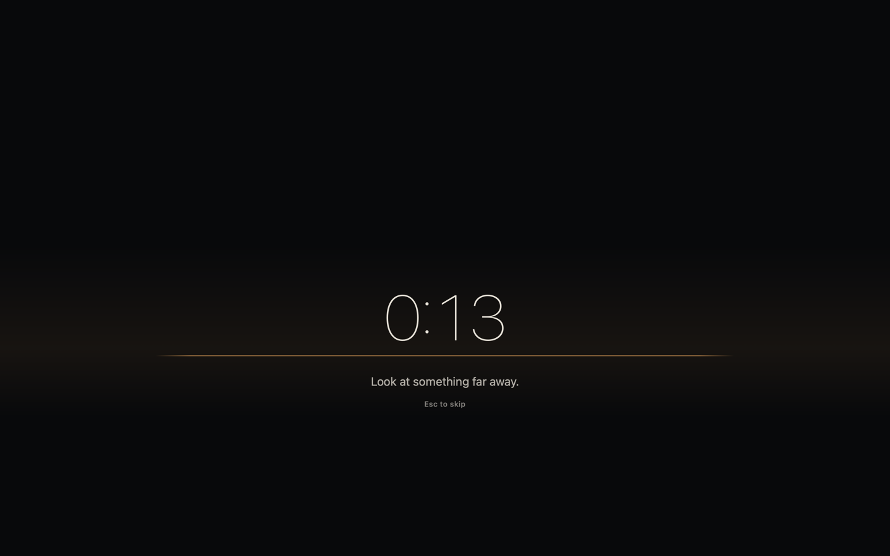

# Away

A tiny macOS menu-bar app that takes the screen away for eye breaks — the thing
EyeLeo does on Windows, rebuilt native for the Mac.



- **Short breaks**: 20 seconds every 20 minutes.
- **Long breaks**: 5 minutes every third short break.
- A dark full-screen surface on every display, including full-screen apps. The
  amber horizon is the timer; it drains as the break runs out.
- **Esc** skips. **Strict mode** means Esc doesn't.
- **Idle-aware**: if you were already away for a couple of minutes, it banks
  the rest instead of firing a stale break.
- **Pause** for 15 / 30 / 60 / 120 minutes from the menu.
- No permissions, no network, no accounts, no Dock icon.

## Install

```sh
./install.sh
```

That builds, puts `Away.app` in `~/Applications`, and opens it. Look for the eye
in the menu bar; click it for settings, pause, and manual breaks.

Set **Open at login** in Settings. Put the app in `/Applications` (or
`~/Applications`, as `install.sh` does) before enabling it — macOS login items
need a stable home.

## Build and test

```sh
./build.sh          # runs the schedule tests, then builds build/Away.app
./build.sh render   # also writes build/previews/*.png for design review
```

Requirements: macOS 14+, Xcode command-line tools. No package manager, no
dependencies.

Dev hooks: `--preview-short` shows a break right after launch and quits when it
ends; `--no-idle` ignores the away check, useful with shortened intervals:

```sh
./build/Away.app/Contents/MacOS/Away --no-idle -shortMinutes 1 -shortSeconds 5
```

## What's inside

| Path | What |
|---|---|
| `Sources/Schedule.swift` | Pure break logic: phases, deadlines, idle rule, pause. No AppKit. |
| `Sources/AppDelegate.swift` | Menu bar, timer pump, overlay lifecycle. |
| `Sources/Overlay.swift` | One borderless window per display, above every space. |
| `Sources/BreakView.swift` | The break surface: horizon timer. |
| `Sources/SettingsView.swift` | Native grouped settings form. |
| `Tests/ScheduleTests.swift` | Assert-based tests for the schedule, no test framework. |

## Limits

- One schedule, one user. No history or stats.
- Strict mode can still be quit with ⌘Q or Force Quit. It is a commitment
  device, not a lock.
- Apple silicon build by default (it targets the current machine's arch).
- The app is ad-hoc signed. It runs locally; it is not notarized for
  distribution to other Macs.
